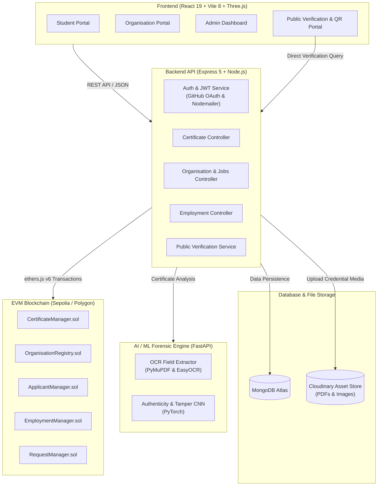

# 🎓 SkillSync

<div align="center">


**Next-Generation Decentralized Academic & Professional Credential Issuance, Tamper-Proof Verification, and AI-Powered Authenticity Detection**

[](https://soliditylang.org/)
[](https://ethereum.org/)
[](https://nodejs.org/)
[](https://expressjs.com/)
[](https://react.dev/)
[](https://vitejs.dev/)
[](https://tailwindcss.com/)
[](https://fastapi.tiangolo.com/)
[](https://pytorch.org/)
[](https://www.mongodb.com/)

[Key Features](#-key-features) • [Architecture](#-system-architecture) • [Project Structure](#-project-structure) • [Smart Contracts](#-smart-contracts) • [AI & ML Service](#-ai--ml-service) • [Getting Started](#-getting-started) • [Environment Setup](#-environment-variables) • [API Overview](#-api-endpoints)

</div>

---

## 📌 Overview

**SkillSync** is a unified platform bridging web3 decentralization, artificial intelligence, and credential management. It empowers educational institutions and enterprises to securely issue tamper-proof certificates, manage student achievements, and verify candidate credentials with mathematical finality on EVM-compatible blockchains (Sepolia / Polygon).

In addition to immutable on-chain hashing, SkillSync incorporates a dedicated **Deep Learning & Computer Vision engine** that performs forensic authenticity analysis on incoming credentials—detecting manipulated text, replaced signatures, forged logos, and missing security markers—alongside automated OCR field extraction.

---

## ✨ Key Features

### 🏛️ Multi-Role Ecosystem
- **Students / Candidates**:
  - Centralized portfolio with blockchain-verified academic & skill credentials.
  - One-click GitHub account linking for repository sync and code proof.
  - Project verification requests directed to collaborating organizations.
  - Job exploration, application tracking, and employment offer acceptance.
- **Organizations / Universities / Employers**:
  - One-click digital certificate issuance anchored to smart contracts.
  - Automated certificate cryptographic hashing (SHA-256) and Cloudinary hosting.
  - Review and approve student project verification requests.
  - Job opening creation and Applicant Tracking System (ATS).
  - Employee management and role tracking on-chain.
  - Built-in AI extractor and tamper-check tools for external certificates.
- **Platform Administrators**:
  - Organization verification and whitelist lifecycle management.
  - Global platform analytics and audit logging.
  - Smart contract interaction oversight.

### ⛓️ Blockchain Integrity & Public Verification
- **Cryptographic Certificate Anchoring**: Certificates are hashed with SHA-256 and stored on-chain with issuer signature and recipient public keys.
- **Zero-Friction Public Verification**:
  - Verify via unique Certificate ID or blockchain transaction hash.
  - Real-time QR Code scanning on mobile or desktop.
  - Trustless validation directly against Ethereum/Polygon smart contracts without requiring login.

### 🤖 AI-Powered Forensics & OCR
- **Certificate Forgery & Tamper Detection**:
  - Detects altered recipient names, tampered dates, modified logos, fake signatures, and omitted QR codes.
  - Provides a confidence score and forensic tamper probability.
- **OCR Field Extraction**:
  - Automatically parses PDF and high-res image certificates to extract student names, issuing body, credential titles, and dates.

---

## 🏗️ System Architecture



---

## 📂 Project Structure

```
SkillSync/
├── BlockChain/                   # Smart Contracts & Hardhat Environment
│   ├── contracts/                # Solidity Contracts (0.8.28)
│   │   ├── ApplicantManager.sol  # Applicant profiles and project records
│   │   ├── CertificateManager.sol# Certificate issuance & hash verification
│   │   ├── EmploymentManager.sol # Proof of employment and company records
│   │   ├── OrganisationRegistry.sol# Approved organization directory
│   │   ├── RequestManager.sol    # Verification requests workflow
│   │   └── libraries/            # Helper libraries
│   ├── hardhat.config.js         # Hardhat network & compiler configuration
│   └── scripts/                  # Deployment & verification scripts
│
├── backend/                      # Node.js / Express REST API Server
│   ├── blockchain/               # Contract ABIs & ethers.js contract bindings
│   ├── config/                   # Database (MongoDB) and Cloudinary configs
│   ├── controllers/              # Business logic (Certificates, Auth, ML, Jobs)
│   ├── middleware/               # JWT authentication, RBAC, Multer uploads
│   ├── models/                   # Mongoose Schemas (User, Certificate, Job, etc.)
│   ├── routes/                   # API endpoint route declarations
│   ├── services/                 # Email (Nodemailer), Cloudinary & external helpers
│   ├── src/                      # App initializers (app.js, server.js)
│   ├── .env.example              # Backend environment template
│   └── package.json
│
├── frontend/                     # React 19 Client SPA
│   ├── src/
│   │   ├── components/           # Reusable UI, Navbars, 3D Canvas, Modals
│   │   ├── context/              # Authentication & State management
│   │   ├── pages/
│   │   │   ├── Home.jsx          # 3D interactive hero landing page
│   │   │   ├── Login.jsx         # Role-aware authentication
│   │   │   ├── Register.jsx      # Multi-step student registration
│   │   │   ├── AdminDashboard.jsx# Admin platform management
│   │   │   ├── student/          # Student dashboard, certificates, jobs, GitHub
│   │   │   ├── Organisation/     # Org dashboard, issuing, ATS, employee portal
│   │   │   └── public/           # QR verification and document tamper scanner
│   │   ├── services/             # Axios API clients
│   │   └── App.jsx               # Router & route protections
│   ├── vite.config.js            # Vite configuration with Tailwind CSS v4
│   └── package.json
│
└── ml/                           # Python Machine Learning Microservice
    ├── api.py                    # FastAPI server exposing /predict and /extract
    ├── detection/                # Tamper detection models & inference logic
    ├── extraction/               # PyMuPDF and OCR text processing
    ├── models/                   # Serialized model weights & configurations
    ├── requirements.txt          # Python dependencies
    └── README.md                 # ML-specific deep dive and dataset schema
```

---

## 📜 Smart Contracts

The blockchain subsystem is built with **Solidity `^0.8.28`** using the **Hardhat** development framework:

| Contract | Purpose |
| :--- | :--- |
| **`CertificateManager.sol`** | Anchors certificates by mapping hash fingerprints to issuer address, student wallet, issuance timestamp, and revocation flags. |
| **`OrganisationRegistry.sol`** | Maintains verified institutional records. Only whitelisted organizations can issue authoritative credentials. |
| **`ApplicantManager.sol`** | Records student credentials, public addresses, and validated project achievements on-chain. |
| **`EmploymentManager.sol`** | Provides decentralized verification for work history, titles, and company affiliations. |
| **`RequestManager.sol`** | Governs student-to-organization verification petitions and approval workflows. |

---

## 🧠 AI & ML Service

The ML microservice is built using **FastAPI** and **PyTorch**:

- **Certificate Forgery & Tamper Detection (`POST /predict`)**:
  - Accepts image or PDF uploads.
  - Automatically rasterizes PDF pages to high-resolution PNGs via PyMuPDF.
  - Runs neural inference to detect anomalies: modified text fields, substituted emblems/seals, forged signatures, or manipulated QR stamps.
- **Metadata OCR Extraction (`POST /extract`)**:
  - Parses certificates to identify and return standard credential fields (Recipient, Issuer, Course Name, Certificate ID, Date) for streamlined data entry.

---

## 🚀 Getting Started

### 📋 Prerequisites
Make sure you have the following installed:
- **Node.js**: v18.0.0 or higher
- **npm** or **yarn**
- **Python**: v3.9+ (with `pip` and virtual environment support)
- **MongoDB**: Local instance or MongoDB Atlas URI
- **Metamask / EVM Wallet**: With Sepolia testnet ETH

---

### 1. Smart Contracts Setup

```bash
cd BlockChain
npm install

# Compile contracts
npx hardhat compile

# Run contract tests
npx hardhat test

# Deploy to Sepolia testnet
npx hardhat run scripts/deploy.js --network sepolia
```
*Note down the deployed contract addresses to configure the backend.*

---

### 2. Backend Setup

```bash
cd backend
npm install

# Create environment configuration
cp .env.example .env
```

Configure your `.env` file with your MongoDB URI, JWT secret, Cloudinary keys, RPC provider, and smart contract addresses (see [Environment Variables](#-environment-variables)).

```bash
# Start backend in development mode (with nodemon)
npm run dev
```
The backend will run on `http://localhost:5000`.

---

### 3. Frontend Setup

```bash
cd frontend
npm install

# Start Vite development server
npm run dev
```
The frontend will launch at `http://localhost:5173`.

---

### 4. ML Service Setup (Optional but Recommended)

```bash
cd ml

# Create and activate virtual environment
python -m venv venv
# On Windows:
venv\Scripts\activate
# On Linux/macOS:
source venv/bin/activate

# Install dependencies
pip install -r requirements.txt

# Run FastAPI server with Uvicorn
uvicorn api:app --host 0.0.0.0 --port 8000 --reload
```
The ML API documentation will be available at `http://localhost:8000/docs`.

---

## ⚙️ Environment Variables

### Backend Configuration (`backend/.env`)

```env
PORT=5000

# Database
MONGO_URI=mongodb+srv://<user>:<password>@cluster.mongodb.net/skillsync?retryWrites=true&w=majority

# JWT Authentication
JWT_SECRET=your_super_secret_jwt_key
JWT_EXPIRES_IN=1d

# Cloudinary Storage
CLOUDINARY_CLOUD_NAME=your_cloud_name
CLOUDINARY_API_KEY=your_cloudinary_api_key
CLOUDINARY_API_SECRET=your_cloudinary_api_secret

# Blockchain Provider & Signer
BLOCKCHAIN_RPC_URL=https://eth-sepolia.g.alchemy.com/v2/your_alchemy_key
BLOCKCHAIN_PRIVATE_KEY=your_private_key_without_0x
ADMIN_PRIVATE_KEY=your_admin_private_key_without_0x

# Deployed Smart Contract Addresses
APPLICANT_MANAGER_ADDRESS=0x...
ORGANISATION_REGISTRY_ADDRESS=0x...
REQUEST_MANAGER_ADDRESS=0x...
EMPLOYMENT_MANAGER_ADDRESS=0x...
CERTIFICATE_MANAGER_ADDRESS=0x...

# Frontend URL
FRONTEND_URL=http://localhost:5173

# Email Service (Nodemailer with Google App Password)
EMAIL_USER=your_email@gmail.com
EMAIL_PASS=your_16_char_google_app_password

# GitHub OAuth App
GITHUB_CLIENT_ID=your_github_client_id
GITHUB_CLIENT_SECRET=your_github_client_secret
GITHUB_CALLBACK_URL=http://localhost:5000/api/student/github/callback
```

### Blockchain Configuration (`BlockChain/.env`)

```env
RPC_URL=https://eth-sepolia.g.alchemy.com/v2/your_alchemy_key
PRIVATE_KEY=your_private_key_hex
```

---

## 📡 API Endpoints

| Category | Method | Endpoint | Description | Auth |
| :--- | :--- | :--- | :--- | :--- |
| **Auth** | `POST` | `/api/auth/register` | Register Student or Organisation | Public |
| | `POST` | `/api/auth/login` | Log in and receive JWT token | Public |
| | `GET` | `/api/auth/me` | Fetch active user session | Bearer JWT |
| **Certificates** | `POST` | `/api/certificate/issue` | Issue new certificate on-chain | Org |
| | `GET` | `/api/certificate/student` | Fetch logged-in student certificates | Student |
| | `GET` | `/api/certificate/:id` | Get certificate metadata by ID | Authenticated |
| **Public Verification** | `GET` | `/api/public/verify/:id` | Verify credential against blockchain | Public |
| | `POST` | `/api/public/verify-hash` | Verify raw document hash | Public |
| **ML & Forensics** | `POST` | `/api/ml/predict` | Run tampering analysis on document | Public / Org |
| | `POST` | `/api/ml/:certificateId/extract` | Run OCR field extraction | Org |
| **Student** | `GET` | `/api/student/profile` | Retrieve student profile & stats | Student |
| | `POST` | `/api/student/project` | Submit project for verification | Student |
| | `GET` | `/api/student/jobs` | Browse active job listings | Student |
| **Organisation** | `GET` | `/api/organisation/jobs` | Manage posted jobs | Org |
| | `POST` | `/api/organisation/jobs` | Post new vacancy | Org |
| | `GET` | `/api/organisation/pending-verifications` | View queued project verification requests | Org |
| | `POST` | `/api/organisation/verify-request/:id` | Approve/Reject verification request | Org |
| **Employment** | `GET` | `/api/employment/my-offers` | Get received job offers | Student |
| | `POST` | `/api/employment/issue-offer` | Issue formal employment offer | Org |

---

## 🛡️ Security & Trust Model

1. **Tamper-Proof Proof of Origin**: Credential SHA-256 hashes are anchored into immutable smart contract state. Any modification of a single pixel or text character invalidates the cryptographic hash.
2. **Role-Based Access Control (RBAC)**: Strict server-side route guards ensure students, organizations, and administrators access only authorized scopes.
3. **Double Verification**: Both machine learning visual forensics (detecting forged formatting or substituted seals) and deterministic blockchain state validation are unified for maximum fraud resistance.
4. **Secure Credential Storage**: Certificates are stored on Cloudinary via signed transfers, ensuring high-availability access while relying on Ethereum/Polygon for truth.

---

## 🤝 Contributing

Contributions make the open-source community an inspiring place to learn, inspire, and create. Any contributions you make are **greatly appreciated**.

1. Fork the Project
2. Create your Feature Branch (`git checkout -b feature/AmazingFeature`)
3. Commit your Changes (`git commit -m 'Add some AmazingFeature'`)
4. Push to the Branch (`git push origin feature/AmazingFeature`)
5. Open a Pull Request

---

## 📄 License

This project is licensed under the **ISC License**.

---

<div align="center">
  <sub>Developed with ❤️ by the <b>SkillSync</b> Team. Building the future of verifiable credentials.</sub>
</div>
